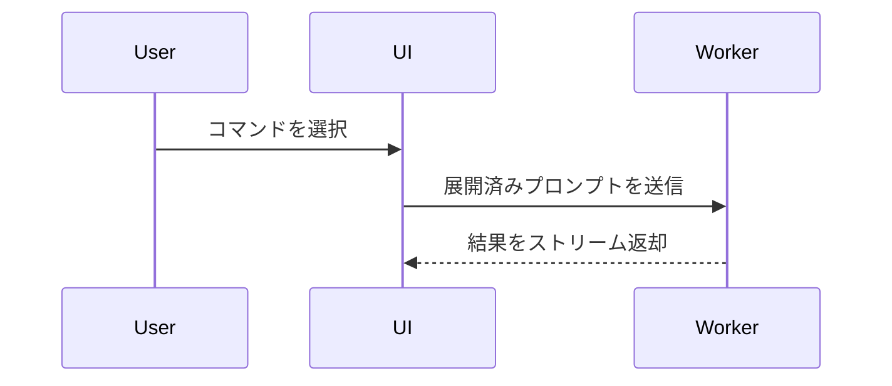

# Show Me

現在の論点を、読み手が一目で構造をつかめる形にする。前置きを置かず、図を先に出し、説明は短く保つ。最小の視覚化で要点が伝わる形式を1つ選ぶ。
 
## まず何を達成したいかを分ける

- **見せる**: 観測したコード・挙動・検証結果を理解・レビューできる形にする。このSkillが最小形式を選ぶ。
- **正しいか調べる**: 状態遷移テストやTLA+/TLCの検査を先に実行する。pstackの `/statechart` はTLCで検査したTLA+モデルのMermaid図を作る。図の生成自体は不変条件が成り立つ証拠ではない。反例・検査範囲・未実行事項を隠さない。
- **人がコード行にコメントする**: `/difit`。デザインされた差分説明・計画レビュー資料は、導入先で使えるときだけ `visual-explainer` を使う。
- **複雑なシステム構造を継続的に編集する**: specを正本とする `/archify` を優先。プレゼン用HTMLの表現を設計の正本にしない。

`visual-explainer` はPR #651でClaude/Piに導入するnative pluginであり、すべてのruntimeにあるとは限らない。存在しないruntimeで「実行済み」と扱わない。

## いつ使うか・何を出すか

- 明示的な「図解して」「全体像を見せて」だけでなく、設計判断・原因調査・レビュー・変更影響の説明で**関係や遷移を視覚化した方が判断が速い**場合にも発火する。
- 複数主体間のやり取り、分岐、状態遷移、依存関係、変更前後の差は候補。単純なFAQ・一行の原因・図にしても情報が増えない説明は文章のままにする。
- まず対象コード・仕様・観測値を確認し、必要な要素と矢印を確定する。未確認事項を推測で図示しない。
- 図を選んだら**図そのものを提示**する。Mermaidは描画可能なコード、repoに残す図は編集可能なソース＋レンダリング成果物、HTMLは実ファイルと生成・確認結果を示す。ツール名や作成予定だけ報告して完了にしない。
- ユーザー指定の形式があれば優先し、未指定なら目的・閲覧先・実行できるツールに合わせて自分で選ぶ。生成・レンダリングが使えない場合は、その事実と代替形式を明示する。

## 形式の選び方

- **ロジック・アルゴリズム**: 疑似コード

```text
保存
  内容が変わっていない
    キャッシュ結果を返す
  新しい内容を書き込む
  新しい結果を返す
```

- **runtimeの制御フロー**: 呼び出し木

```text
submitForm
  createSession
    persistPrompt
    launchAgent
  navigateToSession
```

- **UI構造**: 状態と重要なモジュール境界を含むコンポーネント木

```tsx
<SessionPage> (apps/example/src/routes/session.tsx)
  useSessionEvents()
  <SessionToolbar>
    <RunSkillButton> (packages/ui)
```

- **ファイル責務・広いリファクタリング**: 浅いファイルツリー

```text
src/
├── commands/       # ユーザー操作を解釈
├── sessions/       # セッション状態を管理
└── transport/      # APIリクエストを送信
```

- **コンポーネント間の相互作用・処理順・データフロー**: Mermaid



- **何が変わるか**: diff。既存構造が大部分残る場合に使う

```diff
 <SessionPage>
   useSessionEvents()
   <SessionToolbar>
+    <RunSkillButton />
   <SessionTimeline>
+    <SkillResultCard />
```

- **比較・diffレビュー・計画などをリッチなHTMLで見せたい**: `visual-explainer` が利用できればsource HTML → render → 確認を行う。未導入なら従来の1枚HTMLアーティファクトを作るか、簡易形式へ戻す。実際のラベル・データ・対象プロダクトの色・余白を優先する。作成後は絶対パスを報告し、ユーザーの明示依頼なしにブラウザを起動・操作しない（Piの `visual_explainer` には `open: false` を渡す）。

- **システム全体像・多層アーキテクチャ・処理シーケンス・状態遷移**: `/archify`。ノードが8個を超える、層（設計時と実行時、SSOT と配布先など）が2つ以上ある、境界（リポジトリ・セキュリティ・リージョン）を描く必要がある、のどれかに当たるとき。手書きの表・カード列・Mermaid では関係が読み取れないので、テキスト図で妥協しない。

  典型的な誤りは、構造を問われて表やカードの一覧を出すこと。表は要素を数えるためのもので、要素同士の関係と方向は描けない。「全体像がわからない」と言われる出力はたいていこれ。

  実例: `docs/diagrams/harness.architecture.json`（このリポジトリ自身の配布アーキテクチャ）。

## 作成ルール

- 図には、論点に必要な呼び出し、ファイル、props、状態、境界だけを残す。関係ない詳細や想像上の要素を足さない。
- 実在するファイル名・関数名・状態名はそのまま使う。未確認の構造は作らず、必要なら `未確認` と示す。
- コードの説明では全文を貼らず、構造を示す最小の抜粋にする。ただし、ユーザーがコピー可能な対象形状を求める場合は、必要なブロック全体を出す。
- 図だけで意味が曖昧な場合に限り、図の直後に要点を1〜3行で補足する。
- 実装依頼と図解依頼を混同しない。図を作るだけの依頼では、コードや設定を変更しない。
- Mermaid以外の形式が指定されている場合は指定を優先する。未指定なら確認の往復ではなく最適な形式を選ぶ。閲覧先・提出形式など成果物の成立に不可欠な条件が決まらない場合のみ確認する。
- リポジトリに恒久的に残す Mermaid 図（ドキュメントや README での参照用）を作成・更新する場合は、環境依存による文字欠けや背景同色化を防ぐため、ソース（`.mmd`）から Pele で静的 SVG（`.svg`）を事前生成してコミットする（`docs/diagrams/` を推奨、詳細は `docs/evaluations/pele-mermaid-svg-adoption.md`）。
- `/archify` を使う場合は、spec の JSON を成果物として残し、`validate`（showcase）→ `deliver` → `visual-check` を通してから報告する。検証を通していない HTML を完成として出さない。図の修正依頼は HTML ではなく spec に対して行う。

## 前提知識のない読み手

「eli10」や「前提知識なしで」と指定されたら、読み手は因果を追える賢い初心者として扱う。

- 簡単にするのは概念の分解で、言葉ではない。本物の仕組みを正しい用語で説明し、用語は初出で一言定義する。
- たとえ話で仕組みを置き換えない。子ども扱いした言い回しをしない。
- 図を大きく、文を短くする。形式の指定がなく `/archify` の条件にも当たらなければ HTML アーティファクトにする。

## 完了条件

- 図を使う判断をした場合、図の実体（描画可能なソース、または確認済みのファイル）が提示されている。
- 最重要の関係または変化が、選んだ図に含まれている。
- 図の各要素が、確認済みの対象または明示した抽象化に対応している。
- 図を補う説明が必要な場合、その説明が図の読み方と結論だけに絞られている。
