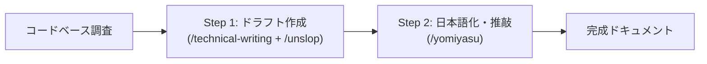

# 技術記事・ドキュメント執筆ワークフロー (Technical Writing Workflow)

`yomiyasu` は利用可能な場合だけ使用する。未導入の場合は、各制約（コードの実名保持・スロップ排除）を保ち、その場で表現だけを推敲する。

コードベースに基づく正確な解説記事・ドキュメントを、高い追跡性と自然な日本語で執筆するための連携ワークフロー。

## 概要と目的

AI が技術記事やドキュメントを書く際、以下の 2 つの課題が頻発する:
1. **コードとの乖離・トレーサビリティの欠如**: AI が勝手に「設定ハンドラ」「データ抽出関数」のような一般的な言い換え・意訳を作成してしまい、読者が実際のコードを `grep` や定義ジャンプで特定できない。
2. **AI スロップと不自然な日本語**: 英語前提の厳格なプロンプトや `/unslop` を直接日本語出力に適用すると、直訳調・硬すぎる体言止め・不自然な表現になり、逆に何もしないと陳腐な AI スロップ（「〜を見ていきましょう」「〜は不可欠です」）が混入する。

本ワークフローでは、**`/technical-writing`（pstack）× `/unslop` × `/yomiyasu`** をパイプラインとして連携させ、「コードベースが単語帳」原則による厳密なトレーサビリティと、淀みのない読みやすい技術日本語を両立させる。

## コア原則

### 1. コードベースが単語帳（Codebase as Glossary）
- **同義語や意訳の禁止**: コードベースに実在するシンボル名・クラス名・関数名・定数名・ファイルパス・CLI フラグ・コマンド名・設定キーをそのまま正確に使用する。
- **検索性の保証**: 読者が記事に登場する名前をそのままエディタで検索して、該当コードへ直ちに到達できるようにする。
- **バッククォートの徹底**: シンボル名やファイルパス、コマンドは必ずバッククォート（`` `...` ``）で囲む。

### 2. AI スロップの徹底排除（No AI Slop）
- 形式的で中身のない導入（「本記事では〜」「〜の旅へ出かけましょう」）や、空疎な結び（「まとめ」「〜の活用が不可欠です」）を削る。
- 主張の前置き（「重要なのは〜」「言うまでもなく〜」）や、感情のない装飾的形容詞（「強力な」「革新的な」）を排除する。

### 3. 自然で淀みのない技術日本語（Natural Technical Japanese）
- コード識別子（英単語・パス・記号）や Markdown 構造は厳格に維持したまま、周囲の文言を自然な日本語表現に推敲する。
- 翻訳調の比喩や擬人化を避け、事実と技術的因果関係を簡潔に述べる。

## 実行パターン

### パターン A: ワンショット指定（短い解説・関数/モジュール解説）

セッション内で直接指示を出す場合は、以下のように `/technical-writing` と `/yomiyasu` を同時に指定する:

```
/technical-writing explain <対象のコード・モジュール・機能> with /yomiyasu
```

- **エージェントの振る舞い**:
  1. コードベースを調査し、実在するシンボル名・ファイルパスを特定する。
  2. 構成・論理・シンボルの選定は `/technical-writing`（コードベースが単語帳、事実先行、スロップ排除）に従う。
  3. 出力テキストは `/yomiyasu` の規範に従い、自然で読みやすい技術日本語として成形する。

### パターン B: 2段階パイプライン（長文技術記事・公式ドキュメント）

より品質を研ぎ澄ませる場合、または大規模なドキュメント作成では、2 段階に分割して実行する:



1. **Step 1: 高密度な骨子・ドラフト作成**
   - 指示: `/technical-writing explain <target> using exact codebase symbols and apply /unslop`
   - 出力: コードベースの実名を固定し、余計なスロップを削ぎ落とした高密度なドラフト（英語または最小限の構成）。
2. **Step 2: 日本語化と最終推敲**
   - 指示: `このドラフトを /yomiyasu を使って自然な技術日本語に推敲・翻訳して。コードシンボル名、ファイルパス、Markdown構造は完全に維持すること。`
   - 出力: トレーサビリティを完璧に維持した、流暢で読みやすい日本語ドキュメント。

## 要所ごとの使い分け（PR本文・日常会話・ドキュメント）

「コードベースが単語帳」原則と脱スロップ推敲は、場面の重さに応じて以下のように使い分ける。

| 場面 | 推敲・執筆のやり方 | 理由・ポイント |
| --- | --- | --- |
| **PR 本文の作成** | 差分の実名・事実を固めた後、`yomiyasu --domain business` で最終推敲（`rules/pr-body.md`） | 多段階スキルは回さず、差分から正確なシンボル・ファイル名を抜き出し、最後に `yomiyasu` を通すだけで十分高品質になる |
| **日常のコード解説・進捗報告** | スキル呼び出しなし。思考上で「コードベースが単語帳＋スロップ排除」を直接適用 | 1回答ごとにスキルを回すと遅延とトークン消費が過大になるため、原則を直接守って簡潔に回答する |
| **仕様書作成・BLOCKED 質問** | 判断材料・選択肢・既存契約の実名を揃えた後、`yomiyasu` で最終推敲（`spec-ready`） | 人間の判断を仰ぐ要所だけ `yomiyasu` で整え、コード識別子はそのまま保持する |
| **本格的な技術記事・解説ドキュメント** | 本スキル（`/tech-writing-workflow`）のワンショットまたは 2 段階パイプライン | 読者のトレーサビリティと記事としての読みやすさを両立するため、`/technical-writing` + `/unslop` + `/yomiyasu` をフル連携 |
| **書籍原稿・長文の論証構造設計** | `/japanese-tech-writing` | パラグラフライティング、反論の先回り、厳密な論証の点検 |
